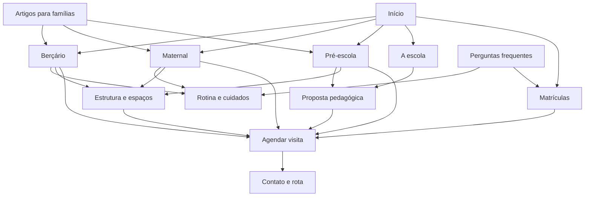

# Arquitetura do site — O Pequeno Galileu

Proposta de 7 de outubro de 2026, fundamentada na [validação dos concorrentes e resultados do Google](concorrentes-google-validacao.md). O [plano editorial, briefings e mapa de clusters](plano-editorial-e-clusters.md), os [textos-base](textos-base-site.md) e o [protocolo de conteúdo sensível](conteudo-sensivel-ymyl.md) detalham a produção. As informações operacionais ainda precisam ser aprovadas pela escola.

## Direção

O site deve permitir que a família encontre a etapa da criança, entenda como funciona o cotidiano, avalie a escola e solicite uma visita. A localização principal será **Rio Pequeno, São Paulo**. Butantã pode contextualizar a região e o acesso, sem apresentar outra unidade ou criar páginas repetidas por bairro.

As páginas comerciais por etapa são sustentadas pelos resultados de berçário Butantã. A presença de diretórios e redes sociais nas consultas do Rio Pequeno reforça a necessidade de informação institucional própria. As posições observadas ajudam a selecionar referências e formatos; não demonstram que a estrutura sozinha causou o ranking.

## Navegação e hierarquia

**Menu:** A escola · Etapas · Rotina e cuidados · Estrutura · Matrículas · Contato.  
**Ação destacada:** Agendar visita.  
**A escola:** apresentação + proposta pedagógica.  
**Etapas:** Berçário + Maternal + Pré-escola, com idades confirmadas no submenu quando possível.  
**Rodapé:** contatos, localização, perguntas frequentes, conteúdo para famílias, Instagram, privacidade e termos.

```text
Início /
├── A escola /a-escola
│   └── Proposta pedagógica /proposta-pedagogica
├── Etapas [agrupamento de navegação]
│   ├── Berçário /bercario
│   ├── Maternal /maternal
│   └── Pré-escola /pre-escola
├── Rotina e cuidados /rotina-e-cuidados
├── Estrutura e espaços /estrutura-e-espacos
├── Matrículas /matriculas
│   └── Agendar visita /agendar-visita [CTA global]
├── Contato /contato
├── Perguntas frequentes /duvidas-frequentes [apoio]
├── Conteúdo para famílias /blog [publicação com revisão]
│   └── Artigos /blog/[slug]
├── Privacidade /privacidade
└── Termos /termos-de-uso
```

“Etapas” será um agrupamento de menu com links acessíveis, sem necessidade de uma página vazia só para reunir três cartões. A página inicial já fornecerá essa visão geral. Uma futura página `/educacao-infantil` só se justifica se houver conteúdo de comparação/organização das etapas que ajude a família além das páginas existentes.

## Páginas, intenção e prioridade

| Página | Responsabilidade | Consulta/necessidade atendida | Ação principal | Situação no projeto |
| --- | --- | --- | --- | --- |
| `/` | Apresentar escola, bairro, etapas e motivos verificáveis para visitar | Escola infantil no Rio Pequeno; educação infantil na região | Encontrar etapa ou agendar visita | Existente; reorganizar |
| `/bercario` | Explicar atendimento de bebês e cuidados específicos | Berçário no Rio Pequeno; idade, adaptação, rotina | Visitar o berçário | Existente; aprofundar |
| `/maternal` | Explicar agrupamentos e cotidiano de crianças pequenas | Escola maternal no Rio Pequeno; grupos e autonomia | Conversar sobre a etapa | Existente; aprofundar |
| `/pre-escola` | Explicar agrupamentos, experiências e continuidade | Pré-escola no Rio Pequeno; idade/Pré I/Pré II | Visitar a pré-escola | Existente; aprofundar |
| `/a-escola` | Identidade, história, equipe e contexto institucional | Quem é a escola; confiança | Conhecer proposta e visitar | Existente; aprofundar |
| `/proposta-pedagogica` | Explicar como a escola ensina por exemplos reais | Metodologia, brincar, acompanhamento | Conhecer a etapa da criança | Nova; prioridade de lançamento |
| `/rotina-e-cuidados` | Responder dúvidas operacionais comuns às etapas | Alimentação, sono, adaptação, horários, família | Encontrar respostas ou conversar | Nova; prioridade de lançamento |
| `/estrutura-e-espacos` | Apresentar ambientes e seu uso | Fotos da escola, estrutura, acesso | Conhecer presencialmente | Existente; substituir mocks |
| `/matriculas` | Explicar processo, períodos e proposta comercial | Matrículas, disponibilidade, documentos e investimento | Solicitar visita/orientação | Existente; aprofundar |
| `/agendar-visita` | Capturar uma solicitação com expectativa clara | Quero conhecer a escola | Solicitar visita | Existente; integrar atendimento |
| `/contato` | Dar localização e canais funcionais | Endereço, telefone, rota, atendimento | Abrir rota ou canal | Existente; validar dados |
| `/duvidas-frequentes` | Organizar respostas aprovadas por tema | Dúvidas de escolha e ingresso | Ir à etapa ou visita | Nova; apoio no rodapé |
| `/blog` e artigos | Conteúdo útil com responsabilidade editorial | Adaptação, escolha de escola, desenvolvimento | Relacionar tema a etapa/visita | Existentes; publicar após revisão |
| `/privacidade`, `/termos-de-uso` | Explicar uso de dados e condições do site | Transparência | Consultar informação | Existentes; adequar à operação |

As consultas são alvos de intenção, sem estimativa de volume ou dificuldade nesta pesquisa. Nomes de turmas e intervalos etários precisam ser aprovados pela coordenação. Nenhuma nomenclatura de concorrente será transposta automaticamente para o Galileu.

## Seções de cada página, na ordem de leitura

### Início

1. **Apresentação:** nome, educação infantil/berçário, Rio Pequeno, frase concreta, foto real e “Agendar visita”.
2. **Escolha a etapa:** três cartões com faixa etária confirmada, resumo e destino próprio.
3. **O cotidiano:** pequenos exemplos de cuidado, vínculo, brincar e comunicação que a escola efetivamente pratica.
4. **Proposta pedagógica:** três ou quatro princípios com um exemplo de experiência; link para a página completa.
5. **Conheça os espaços:** fotos locais com nome e função do ambiente; link para galeria.
6. **Quem acompanha a criança:** apresentação curta da equipe/direção, com informações aprovadas.
7. **Experiências das famílias:** depoimentos reais e autorizados, com fonte/data quando aplicável. Omitir o bloco enquanto não houver material.
8. **Visita e matrículas:** o que acontece depois do contato e por que visitar; campanha anual apenas se confirmada.
9. **Dúvidas essenciais e localização:** horários/etapas/adaptação em respostas curtas, endereço, rota e CTA final.

O blog pode aparecer em um bloco adicional quando tiver conteúdo revisado. A campanha anual não deve ocupar mais destaque que as informações permanentes de etapa e localização.

### Berçário

1. Apresentação, idade de ingresso confirmada, bairro e CTA.
2. Adaptação: como começa, participação da família e acompanhamento.
3. Rotina do bebê: alimentação, descanso, higiene e ritmo individual; explicar práticas reais e evitar apresentar um exemplo como agenda rígida universal.
4. Descobertas: exemplos de estímulos, movimento, linguagem e interação observados na escola.
5. Ambientes do berçário: fotos e função de cada espaço existente.
6. Equipe e comunicação: quem acompanha, informações trocadas com a família e canais existentes.
7. Períodos/horários disponíveis e relação com calendário; link para Matrículas e Rotina.
8. FAQ específico: idade, alimentação, sono, itens de uso, adaptação e visita.
9. Convite para conhecer o berçário.

Base de formato: página da Lua de Algodão e páginas de etapa de CDI/Coala. As práticas citadas por elas não são atributos confirmados do Galileu.

### Maternal

1. “Escola maternal no Rio Pequeno”: grupos, idades confirmadas e CTA.
2. O que caracteriza a etapa: linguagem, convivência, movimento e autonomia em exemplos locais.
3. Um cotidiano de brincadeiras: sequência ilustrativa de experiências reais.
4. Cuidados e transições: acolhimento, higiene, descanso e desfralde, conforme a prática validada.
5. Espaços e materiais usados pelo grupo, com fotos.
6. Como a família acompanha o desenvolvimento.
7. Períodos e atividades realmente oferecidos, com distinção do que está incluído.
8. FAQ da etapa e visita.

“Maternal” isolado gerou ambiguidade na busca; título, introdução e metadados devem explicitar o contexto escolar. O conteúdo da página se justifica pela experiência e escolha da família, mesmo sem volume de busca medido.

### Pré-escola

1. Apresentação, grupos e idades confirmadas, CTA.
2. Como os grupos são organizados e como obter orientação para ingresso.
3. Experiências de brincar, investigar, expressar e conviver, alinhadas à proposta aprovada.
4. Projetos reais: pequena narrativa com foto, atividade e intencionalidade pedagógica.
5. Acompanhamento do desenvolvimento e diálogo com a família.
6. Continuidade/transição para o Ensino Fundamental: orientação que a escola efetivamente oferece, sem prometer desempenho ou alfabetização precoce.
7. Ambientes, períodos e atividades da etapa.
8. FAQ: idade, grupos, rotina, ingresso e continuidade; CTA final.

As perguntas sobre idade e Pré I/Pré II vieram do Google. Os nomes e critérios do Galileu serão fornecidos pela escola; regras de ingresso só serão redigidas após verificação aplicável.

### A escola

1. Identidade e apresentação da instituição.
2. História com datas/marcos confirmados; a bio pública declara 25 anos, mas esse número precisa de data-base antes de virar texto permanente.
3. Direção, coordenação e equipe, com nomes, função e formação autorizados.
4. Relação com famílias e comunidade, ilustrada por iniciativas reais.
5. Informações institucionais verificadas, incluindo autorização atual quando documentada.
6. Links para proposta, etapas e espaços; visita.

### Proposta pedagógica

1. Síntese da proposta na linguagem da própria escola.
2. Princípios e o que significam no cotidiano.
3. Exemplos por etapa, com registros/fotos e contexto.
4. Planejamento, observação e documentação do desenvolvimento.
5. Relação com interações, brincadeira e campos de experiências da BNCC, revisada pela coordenação.
6. Parceria com famílias; links para etapas e convite à visita.

Não atribuir abordagens como Montessori, Reggio Emilia, bilinguismo ou ensino construtivista à escola por semelhança com referências.

### Rotina e cuidados

1. Visão geral de como a rotina se organiza por faixa etária.
2. Acolhimento e adaptação.
3. Alimentação: preparo, acompanhamento, restrições e comunicação conforme operação real.
4. Sono, higiene e desfralde por etapa.
5. Procedimentos de entrada/saída e cuidados cotidianos validados.
6. Comunicação com responsáveis e acompanhamento pedagógico.
7. Períodos, horários, calendário/férias e o que a família precisa saber.
8. Respostas curtas e links para etapa, Matrículas e visita.

Uma página reúne processos comuns; nas etapas ficam os detalhes específicos. Curso de férias aparece nos destaques públicos do Instagram, mas oferta atual e condições precisam de confirmação.

### Estrutura e espaços

1. Apresentação do espaço com foto real.
2. Galeria organizada por ambientes efetivamente existentes.
3. Uso dos ambientes por etapa: cuidado, brincar, alimentação, descanso e movimento.
4. Entrada, saída, circulação/acessibilidade e orientações de acesso confirmadas.
5. Mapa/link para Contato e visita presencial.

Cada foto terá identificação do ambiente, legenda útil e autorização de uso. Não inferir existência de lactário, solário, horta ou enfermaria a partir de concorrentes.

### Matrículas

1. Oferta e ano letivo vigente, quando confirmado.
2. Como funciona: primeiro contato → visita/conversa → proposta e orientação → matrícula conforme disponibilidade.
3. Etapas, períodos e horários ofertados.
4. Investimento e inclusões: publicar valores apenas se aprovados e datados; caso contrário, explicar como solicitar proposta e quais itens ela detalha.
5. Documentos e critérios, aprovados pela secretaria.
6. Dúvidas de matrícula: disponibilidade, adaptação, início e calendário.
7. CTA para visita e contato para orientação.

Não repetir aqui o formulário completo da página de agendamento. A transparência de períodos no Vital Brazil é uma referência de formato, não um parâmetro de preço do Galileu.

### Agendar visita

1. O que a família conhecerá: espaços, proposta e conversa com a equipe.
2. Solicitação curta: responsável, contato e etapa/idade aproximada; e-mail e mensagem opcionais conforme necessidade.
3. Preferência de período para retorno/visita, se o atendimento utilizar essa informação.
4. Aviso de privacidade e expectativa de resposta definida pela equipe.
5. Confirmação do envio com próximo passo; a solicitação só se torna agendamento após confirmação da escola.
6. Alternativa por WhatsApp e orientação de chegada.

O primeiro contato não exige documentos, nome completo da criança ou data exata de nascimento. Esses dados podem ser coletados mais adiante quando necessários à matrícula.

### Contato

1. Endereço completo confirmado e referência de acesso útil.
2. Google Maps/Waze para traçar rota.
3. Telefone, WhatsApp e e-mail validados.
4. Horário de atendimento e distinção de horário escolar, se forem diferentes.
5. Link para solicitar visita e Instagram público.

### Perguntas frequentes

1. Navegação por temas: ingresso/etapas, adaptação, rotina/cuidados, períodos, visita/matrícula.
2. Respostas diretas aprovadas, com links para explicações completas.
3. CTA para uma dúvida não respondida.

Usar as mesmas respostas nos trechos de FAQ das etapas e de Matrículas para evitar contradições. O propósito é ajudar famílias; não contar com destaque especial de FAQ no Google.

## Relações entre páginas



Exemplos: a família de um bebê chega à página de Berçário, confere cuidados e pede visita; a família comparando instituições chega à inicial, conhece proposta/espaços e vai a Matrículas; a família pronta para visitar chega a Contato e encontra rota e canais.

## Implantação e critérios de conteúdo

1. **Base institucional:** confirmar domínio/canais, grupos/idades/períodos, história e responsáveis; levantar fotos e informações operacionais.
2. **Páginas comerciais:** reorganizar Início e aprofundar Berçário, Maternal, Pré-escola, Matrículas, Visita e Contato.
3. **Páginas de confiança:** criar Proposta pedagógica e Rotina e cuidados; aprofundar A escola/Estrutura; organizar FAQ.
4. **Conteúdo editorial:** revisar os artigos existentes, garantir autoria/revisão e integrar links para etapas.
5. **Publicação:** integrar atendimento, revisar conteúdo e dados locais e levantar URLs antigas para preservar/redirecionar o que for aplicável.

Cada seção terá objetivo, conteúdo aprovado, evidência/material real e próximo passo. Blocos com serviço não confirmado permanecerão no planejamento até confirmação. Bilíngue, integral, curso de férias, cardápio e área da família só ganham páginas próprias quando houver oferta real e conteúdo suficiente para atender uma necessidade distinta.

Preservar os caminhos existentes `/bercario`, `/maternal`, `/pre-escola`, `/a-escola`, `/estrutura-e-espacos`, `/matriculas`, `/agendar-visita` e `/contato`. O site antigo vinculado no Google não pôde ser aberto nesta sessão; o inventário de URLs antigas e os redirecionamentos continuam como etapa antes da publicação. Esta proposta ainda não altera telas, contatos ou serviços no site.
