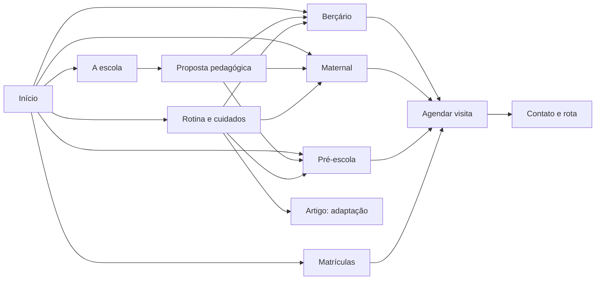

# Plano editorial e arquitetura de conteúdo — O Pequeno Galileu

**Versão:** 7 de outubro de 2026. **Estado:** plano e textos em elaboração; nenhuma informação operacional abaixo substitui a confirmação da escola. Complementa a [arquitetura](arquitetura-site.md) e a [validação dos resultados do Google](concorrentes-google-validacao.md).

**Implementação da prévia:** as páginas e os links deste plano foram montados no projeto Astro com dados provisórios. Use o [briefing de informações do Galileu](briefing-informacoes-galileu.md) para substituir os mocks; fotos e vídeos ficam na última etapa. Enquanto a prévia estiver ativa, o site usa `noindex`, os artigos permanecem como rascunhos e o formulário não envia dados.

A [auditoria de blocos e enriquecimento](auditoria-blocos-e-enriquecimento.md) compara cada página montada com o conteúdo planejado e ordena o trabalho que falta.

## 1. Decisão editorial

A arquitetura responde a quatro perguntas, nesta ordem: **atende a idade da criança?**, **como é o dia?**, **por que confiar?** e **como conhecer a escola?** A página inicial é o hub comercial. As três etapas têm páginas próprias porque as famílias procuram informações diferentes para bebês, crianças do maternal e pré-escola. Proposta pedagógica e Rotina e cuidados são hubs de aprofundamento. Blog só entra quando acrescenta uma resposta que não cabe nas páginas de serviço.

O foco local é **Rio Pequeno, São Paulo**. Butantã pode ser citado como região de referência quando natural. Não criar versões quase iguais por bairro ou por variações de palavra-chave. As buscas observadas não forneceram volumes, dificuldade ou previsões de tráfego. A amostra de cinco resultados mostrou quatro domínios coincidentes entre “escola infantil Rio Pequeno” e “pré-escola Rio Pequeno”; isso indica relação temática, mas não prova que uma única página atenderá as duas intenções. As páginas terão informação exclusiva e links entre si.

## 2. Prioridade de produção

| Lote | Entrega | Por que vem agora | Critério de conclusão |
| --- | --- | --- | --- |
| 0 — fatos | Ficha oficial da escola, contatos, faixas etárias, períodos, proposta, processos, fotos e autorizações | Sem esses dados, a cópia pública pode induzir famílias a erro | Coordenação/secretaria aprovaram uma ficha com data e responsável |
| 1 — percurso de visita | `/`, `/bercario`, `/maternal`, `/pre-escola`, `/matriculas`, `/agendar-visita`, `/contato` | Responde às consultas de maior intenção e permite solicitar visita | Cada etapa tem conteúdo próprio, dados reais e CTA funcional |
| 2 — confiança | `/a-escola`, `/proposta-pedagogica`, `/rotina-e-cuidados`, `/estrutura-e-espacos`, `/duvidas-frequentes` | Responde objeções e demonstra prática concreta | Exemplos e imagens conferidos pela equipe; perguntas sem contradição |
| 3 — editorial | `/blog` e três artigos existentes | Apoia dúvidas de famílias e cria caminhos para as etapas | Autoria, revisão e fontes registradas; conteúdo provisório removido |
| 4 — publicação | Privacidade, termos, metadados, navegação, links e URLs antigas | Evita informações desencontradas e perda de caminhos | Revisão jurídica/operacional e inventário de redirecionamentos concluídos |

Não publicar oferta, período, preço, idade, equipe, instalação, depoimento, horário ou protocolo que a escola não tenha confirmado. O telefone e o WhatsApp de `src/data/site.ts` são valores provisórios. A bio pública informa “25 anos”, mas a data de fundação precisa ser verificada antes de inserir essa afirmação em texto permanente. Os três artigos hoje são modelos genéricos, embora tenham datas de publicação no código; confirmar cronologia real ou retirar as datas.

## 3. Ficha de fatos que alimenta todas as páginas

| Informação | Dono sugerido | Onde será usada |
| --- | --- | --- |
| Nome institucional, endereço, localização, domínio, telefone, WhatsApp, e-mail, horários de atendimento | Direção/secretaria | Todas as páginas, rodapé, dados estruturados, Google Business Profile |
| Faixa etária e nomes de turmas por etapa; vagas, períodos e calendário | Coordenação/secretaria | Início, etapas, matrículas, FAQ |
| Como funcionam adaptação, alimentação, descanso, higiene, retirada e comunicação | Coordenação e responsáveis operacionais | Rotina, berçário, maternal, FAQ |
| Princípios pedagógicos e um exemplo documentado por etapa | Coordenação pedagógica | Proposta, etapas, início |
| Formação e papéis da equipe; história e autorização institucional vigente | Direção | A escola, proposta, início |
| Fotos de ambientes com nomes, data e autorização de uso; depoimentos autorizados | Direção/comunicação | Início, estrutura, etapas |
| Formulário, destinatário dos dados, canal de resposta, política de retenção | Responsável pelo site/privacidade | Agendar visita, contato, privacidade |

## 4. Briefings de páginas

Em cada briefing, **título SEO** é uma proposta editorial a revisar após confirmação dos fatos. A descrição deve resumir a página real; a presença da palavra-chave nunca justifica promessa adicional. H2 são blocos de informação, não contagem obrigatória de texto.

### `/` — hub comercial

- **Intenção:** conhecer uma escola de educação infantil no Rio Pequeno e escolher a etapa.
- **H1:** Educação infantil no Rio Pequeno: conheça O Pequeno Galileu.
- **Título SEO:** O Pequeno Galileu | Educação infantil no Rio Pequeno.
- **Descrição:** Conheça as etapas, a proposta, a rotina e os espaços de O Pequeno Galileu, no Rio Pequeno. Solicite uma visita à escola.
- **Estrutura:** etapas → cotidiano → proposta → espaços reais → equipe → localização e visita.
- **Prova necessária:** foto real, endereço confirmado, exemplos pedagógicos, equipe e canais conferidos.
- **CTA:** conhecer a etapa ou solicitar visita. **Links:** três etapas, proposta, rotina, estrutura, matrículas e visita.

### `/bercario` — página de etapa

- **Intenção:** avaliar berçário, idade de ingresso, adaptação e cuidados.
- **H1:** Berçário no Rio Pequeno.
- **Título SEO:** Berçário no Rio Pequeno | O Pequeno Galileu.
- **Descrição:** Entenda como é a rotina do berçário, quais informações perguntar à equipe e como conhecer os ambientes de O Pequeno Galileu.
- **Estrutura:** quem atende → adaptação → alimentação/sono/higiene → brincadeiras → ambientes/equipe → dúvidas e visita.
- **Prova necessária:** idade e períodos confirmados, rotina real, fotos do ambiente, responsáveis técnicos pelo cuidado.
- **CTA:** conhecer o berçário. **Links:** rotina, estrutura, proposta, matrículas, visita e artigo de adaptação revisado.
- **Cuidado editorial:** alimentação, sono e segurança exigem revisão especializada; não prometer rotina individualizada até comprovação.

### `/maternal` — página de etapa

- **Intenção:** entender escola maternal, grupos, convivência e autonomia.
- **H1:** Escola maternal no Rio Pequeno.
- **Título SEO:** Maternal no Rio Pequeno | O Pequeno Galileu.
- **Descrição:** Saiba como a escola organiza o maternal, as experiências das crianças e a conversa com as famílias antes da matrícula.
- **Estrutura:** grupos → brincar e linguagem → cotidiano/cuidados → ambientes → acompanhamento → visita.
- **Prova necessária:** grupos/idades, exemplos de atividades, desfralde conforme prática, comunicação com responsáveis.
- **CTA:** conversar sobre o maternal. **Links:** rotina, proposta, estrutura, matrículas, visita.

### `/pre-escola` — página de etapa

- **Intenção:** entender experiências, grupos e continuidade da vida escolar.
- **H1:** Pré-escola no Rio Pequeno.
- **Título SEO:** Pré-escola no Rio Pequeno | O Pequeno Galileu.
- **Descrição:** Conheça a pré-escola, os grupos, as experiências de brincar e aprender e a forma de acompanhar o desenvolvimento.
- **Estrutura:** organização dos grupos → experiências/projetos reais → acompanhamento → espaços → ingresso e visita.
- **Prova necessária:** nomes/idades, projeto real documentado, critério de acompanhamento, períodos.
- **CTA:** conhecer a pré-escola. **Links:** proposta, rotina, estrutura, matrículas, visita.
- **Cuidado editorial:** não prometer alfabetização ou desempenho futuro.

### `/a-escola` — identidade e confiança

- **Intenção:** verificar quem é a instituição e quem cuida das crianças.
- **H1:** Conheça O Pequeno Galileu.
- **Título SEO:** A escola | O Pequeno Galileu, Rio Pequeno.
- **Descrição:** Conheça a história, a equipe e a proposta de O Pequeno Galileu no Rio Pequeno, São Paulo.
- **Estrutura:** identidade → história datada → pessoas → relação com famílias → documentos institucionais verificáveis.
- **Prova necessária:** fundação, nomes/funções/formação autorizados, ato de autorização vigente quando divulgado.
- **CTA:** conhecer a proposta ou visitar. **Links:** proposta, etapas, estrutura e visita.

### `/proposta-pedagogica` — hub pedagógico

- **Intenção:** saber como a escola transforma objetivos pedagógicos em experiências.
- **H1:** Nossa proposta pedagógica.
- **Título SEO:** Proposta pedagógica | O Pequeno Galileu.
- **Descrição:** Veja como a proposta pedagógica se traduz em experiências, observação do desenvolvimento e diálogo com as famílias.
- **Estrutura:** princípios próprios → dois ou três exemplos reais → planejamento/registro → relação com famílias → exemplos por etapa.
- **Prova necessária:** texto aprovado pela coordenação e registros reais. Referir BNCC com interpretação revisada.
- **CTA:** escolher a etapa da criança. **Links:** berçário, maternal, pré-escola, escola e visita.

### `/rotina-e-cuidados` — hub de cotidiano

- **Intenção:** entender como a escola acolhe, organiza o dia e se comunica.
- **H1:** Rotina e cuidados na educação infantil.
- **Título SEO:** Rotina e cuidados | O Pequeno Galileu.
- **Descrição:** Entenda o que perguntar sobre adaptação, alimentação, descanso, higiene e comunicação na rotina da escola.
- **Estrutura:** acolhimento → diferenças por etapa → alimentação/descanso/higiene → entrada/saída → comunicação → perguntas práticas.
- **Prova necessária:** procedimentos por faixa etária, responsável por cada tema e registros de rotina.
- **CTA:** conhecer a etapa ou visitar. **Links:** três etapas, adaptação, FAQ e visita.
- **Cuidado editorial:** procedimentos de saúde, nutrição e segurança precisam de revisão competente antes de publicação.

### `/estrutura-e-espacos` — evidência visual

- **Intenção:** ver os ambientes e entender como são usados.
- **H1:** Estrutura e espaços da escola.
- **Título SEO:** Estrutura e espaços | O Pequeno Galileu.
- **Descrição:** Veja os ambientes reais da escola e entenda como os espaços apoiam as experiências das crianças.
- **Estrutura:** galeria por ambiente → função e etapa → acesso/localização → convite para visita.
- **Prova necessária:** fotos reais, legendas precisas, autorização de uso, informações de acessibilidade conferidas.
- **CTA:** agendar visita. **Links:** etapas, contato e visita.

### `/matriculas` — processo de ingresso

- **Intenção:** entender como solicitar vaga, períodos, valores e documentos.
- **H1:** Matrículas no Pequeno Galileu.
- **Título SEO:** Matrículas | O Pequeno Galileu.
- **Descrição:** Entenda as etapas para conhecer a escola, receber informações de vagas e dar andamento à matrícula.
- **Estrutura:** contato → visita → proposta/condições → documentação → dúvidas.
- **Prova necessária:** disponibilidade, condições, documentos, prazos e responsável por resposta. Preço só com validade definida.
- **CTA:** solicitar visita. **Links:** etapas, FAQ, visita e contato.

### `/agendar-visita` — conversão

- **Intenção:** solicitar contato para conhecer a escola.
- **H1:** Agende uma visita à escola.
- **Título SEO:** Agendar visita | O Pequeno Galileu.
- **Descrição:** Solicite uma conversa para conhecer os espaços, a proposta e a etapa indicada para sua família.
- **Estrutura:** o que será conhecido → campos mínimos → privacidade → confirmação do pedido → alternativa por telefone/WhatsApp.
- **Prova necessária:** canal funcional e prazo de resposta combinado pela equipe.
- **CTA:** enviar solicitação. **Links:** privacidade, contato e rota. O envio é um **pedido**; a escola confirma data e horário.

### `/contato` — localização e canais

- **Intenção:** encontrar endereço, rota e contato confiáveis.
- **H1:** Contato e localização.
- **Título SEO:** Contato e localização | O Pequeno Galileu.
- **Descrição:** Encontre O Pequeno Galileu no Rio Pequeno, São Paulo, e fale com a equipe pelos canais oficiais.
- **Estrutura:** endereço → rota → canais → horários de atendimento → visita.
- **Prova necessária:** endereço completo, links de mapa e canais testados pela escola.
- **CTA:** abrir rota ou solicitar visita. **Links:** visita, matrículas, privacidade.

### `/duvidas-frequentes` — resposta rápida

- **Intenção:** resolver dúvidas antes de entrar em contato.
- **H1:** Perguntas frequentes.
- **Título SEO:** Perguntas frequentes | O Pequeno Galileu.
- **Descrição:** Respostas sobre etapas, adaptação, rotina, visita e matrículas, com caminhos para cada assunto.
- **Estrutura:** etapas/idades → rotina → adaptação → períodos → visita/matrícula.
- **Prova necessária:** mesma fonte de resposta das páginas de etapa e da secretaria; data de revisão.
- **CTA:** falar com a equipe. **Links:** todas as páginas citadas na resposta.

### `/blog` — acervo editorial

- **Intenção:** encontrar orientações para avaliar a escola e compreender a educação infantil.
- **H1:** Conteúdo para famílias.
- **Título SEO:** Conteúdo para famílias | O Pequeno Galileu.
- **Descrição:** Leituras sobre adaptação, cotidiano e perguntas úteis para escolher uma escola de educação infantil.
- **Estrutura:** temas → cartões com resumo/autor/revisão → links para etapas relacionadas.
- **Prova necessária:** cada artigo tem conteúdo final, autor, revisão, fontes e data verdadeira.
- **CTA:** ler o tema ou conhecer a etapa. **Links:** rotina, proposta e etapas.

### `/privacidade` e `/termos-de-uso` — transparência

- **Intenção:** entender o tratamento dos dados enviados e as condições de uso do site.
- **Brief:** redigir com o fluxo real de formulário, provedores, retenção, contatos do controlador e tecnologias utilizadas; revisão jurídica e de privacidade antes de publicar. Evitar modelo genérico que descreva práticas inexistentes. Links no rodapé e ao lado do formulário.

## 5. Artigos existentes: briefings e destino

| URL | Pergunta central e recorte | Conteúdo exclusivo | Ligações | Revisão |
| --- | --- | --- | --- | --- |
| `/blog/adaptacao-escolar-como-acolher-os-primeiros-dias` | Como família e escola podem conversar sobre os primeiros dias? | Perguntas concretas para a visita e sinais cotidianos a relatar à equipe, sem impor um prazo universal | Rotina → Berçário/Maternal → Visita | Coordenação pedagógica; revisão clínica se houver afirmações sobre saúde mental |
| `/blog/introducao-alimentar-com-respeito` | Como perguntar à escola sobre refeições e comunicação durante a introdução alimentar? | Papéis da família e da escola, informação sobre cardápio/restrições, sem orientar idade, consistência, alergia ou tratamento | Rotina → Berçário → Contato | Nutricionista/pediatra para qualquer orientação de saúde/nutrição; validar operação real |
| `/blog/seguranca-na-educacao-infantil` | O que observar e perguntar durante uma visita? | Checklist de perguntas sobre entrada/saída, supervisão, comunicação e ambientes, sem atestar conformidade sem documentação | Estrutura → Rotina → Visita | Direção e responsável técnico/segurança; verificar cada afirmação institucional |

O texto atual dos três artigos é o mesmo modelo genérico; nenhum deve ser tratado como artigo final. O segundo e o terceiro ficam **em revisão antes de qualquer alegação especializada**. Não criar novos artigos para preencher calendário. O primeiro artigo novo após os três pode ser “Como escolher uma escola infantil: perguntas para fazer na visita”, se a escola trouxer respostas e imagens próprias; caso contrário, ampliar FAQ e páginas existentes.

## 6. Mapa de clusters e links internos

### Hub comercial: escolha da escola

`/` → `/bercario`, `/maternal`, `/pre-escola`, `/a-escola`, `/estrutura-e-espacos`, `/matriculas`, `/agendar-visita`. Cada página de etapa → `/` por navegação, além de um link contextual para um hub de apoio. `/matriculas` → `/agendar-visita`; `/agendar-visita` → `/contato` para rota e canais.

### Hub pedagógico: experiências e aprendizagem

`/proposta-pedagogica` → `/bercario`, `/maternal`, `/pre-escola` com âncoras específicas (“experiências no berçário”, “brincadeiras no maternal”, “projetos da pré-escola”). As três etapas → `/proposta-pedagogica` no bloco que explica a aprendizagem. `/a-escola` → `/proposta-pedagogica` no contexto da identidade da escola.

### Hub de rotina: acolhimento e cuidado

`/rotina-e-cuidados` → cada etapa e → artigo de adaptação, quando revisado. `/bercario` e `/maternal` → `/rotina-e-cuidados` dentro do trecho de adaptação/cuidados. Artigo de adaptação → `/rotina-e-cuidados` e → etapa pertinente. Artigo de alimentação, depois da revisão, → `/rotina-e-cuidados` e `/bercario`. Artigo de segurança, depois da revisão, → `/estrutura-e-espacos` e `/agendar-visita`.

### Matriz de links contextuais obrigatórios

| Origem | Destino | Âncora sugerida | Posição natural |
| --- | --- | --- | --- |
| `/` | `/bercario`, `/maternal`, `/pre-escola` | “Conhecer o berçário/maternal/pré-escola” | Cartões de etapas |
| `/` | `/proposta-pedagogica` | “Como pensamos as experiências das crianças” | Bloco da proposta |
| `/` | `/rotina-e-cuidados` | “Entenda a rotina e os cuidados” | Bloco do cotidiano |
| Cada etapa | `/rotina-e-cuidados` | “Veja como organizamos o cotidiano” | Depois da descrição da rotina |
| Cada etapa | `/proposta-pedagogica` | “Conheça a proposta pedagógica” | Depois das experiências |
| Cada etapa | `/estrutura-e-espacos` | “Veja os ambientes da escola” | Bloco de espaços |
| Cada etapa | `/agendar-visita` | “Solicitar uma visita” | CTA inicial e final |
| `/a-escola` | `/proposta-pedagogica` | “Conheça nossa proposta” | Identidade pedagógica |
| `/proposta-pedagogica` | Três etapas | Âncora com o nome da etapa e a experiência | Exemplos por idade |
| `/rotina-e-cuidados` | Três etapas | “Rotina no berçário/maternal/pré-escola” | Particularidades por faixa |
| `/rotina-e-cuidados` | Artigo de adaptação | “Leia sobre os primeiros dias” | Bloco de acolhimento |
| `/estrutura-e-espacos` | `/agendar-visita` | “Conheça os espaços pessoalmente” | Fim da galeria |
| `/matriculas` | `/agendar-visita` | “Solicitar uma visita” | Passo inicial do processo |
| `/duvidas-frequentes` | Página da resposta | Âncora com a ação, como “saiba mais sobre o berçário” | Em cada resposta |
| Cada artigo revisado | Hub + etapa correspondente | Âncora descritiva, nunca “clique aqui” | Próximo passo contextual |

Menu e rodapé ajudam a descoberta, mas não substituem esses links contextuais. Toda URL publicada deve receber ao menos um link de uma página indexável e ter caminho até `/agendar-visita` quando esse for o próximo passo da família. Revisar links ao publicar ou retirar páginas; não apontar para artigo em revisão.

## 7. Padrão de redação e aprovação

1. Redigir a partir da ficha oficial e de exemplos observáveis. Uma frase sobre processo deve dizer **como funciona naquela escola**, quem pode explicar e onde a família verá isso.
2. Separar informação permanente de campanhas, vagas e preços que mudam; acrescentar data de validade quando necessário.
3. Preferir fotos da escola com legendas informativas. Não usar foto genérica para sugerir ambiente inexistente.
4. Revisar metadados depois do texto. Cada URL terá uma função e uma pergunta principal; se duas páginas repetirem a mesma resposta, fundir ou redistribuir conteúdo.
5. Aprovar conteúdo pedagógico com coordenação; conteúdo operacional com secretaria/direção; temas de saúde, segurança e privacidade com profissional competente, como detalhado em [conteúdo sensível e YMYL](conteudo-sensivel-ymyl.md).
6. Antes de lançar, percorrer três caminhos: família de bebê → rotina → visita; família de pré-escola → proposta → matrícula; família que busca a escola pelo nome → endereço/contato. Corrigir qualquer informação conflitante.

## Fontes da direção editorial

- [Resultados observados no Google e concorrentes](concorrentes-google-validacao.md).
- [Google Search Central: conteúdo útil, confiável e feito para pessoas](https://developers.google.com/search/docs/fundamentals/creating-helpful-content).
- [Google Search Central: orientações para conteúdo na Busca com IA](https://developers.google.com/search/docs/fundamentals/ai-optimization-guide).
- [BNCC, versão oficial do MEC](https://basenacionalcomum.mec.gov.br/images/BNCC_EI_EF_110518_versaofinal_site.pdf).
